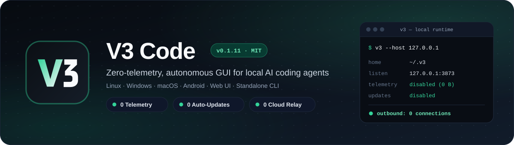
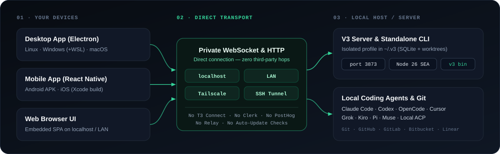

<div align="center">

<picture>
  <source media="(prefers-color-scheme: dark)" srcset="./assets/github/hero-dark.svg" />
  <source media="(prefers-color-scheme: light)" srcset="./assets/github/hero-light.svg" />
  
</picture>

<br />

[](https://github.com/fillvad-cyp/v3-code/releases/tag/v0.2.0)
[](#v3-code-vs-t3-code)
[](#v3-code-vs-t3-code)
[](#download)
[](./LICENSE)

[Русский](./README.md) · **English**

<h3>
  The same fast T3 Code — with zero tracking, zero cloud lock-in,<br />
  and a full suite of features the original doesn't have.
</h3>

<p>
  <a href="#why-people-switch-to-v3-code"><strong>Top Features</strong></a> &nbsp;·&nbsp;
  <a href="#v3-code-vs-t3-code">V3 vs T3 Code</a> &nbsp;·&nbsp;
  <a href="#download"><strong>Download</strong></a> &nbsp;·&nbsp;
  <a href="#architecture">How It Works</a>
</p>

</div>

---

## Why People Switch to V3 Code

### 1. Zero tracking, zero third-party cloud

Official T3 Code sends analytics, routes through cloud relays, pulls remote manifests, and phones home in the background.
**V3 Code rips all of that out.** On startup it makes **0 external connections** — and automatically turns off telemetry for every AI coding agent you run inside it.

### 2. Pop-up / Pop-out chat windows + Always-on-Top (PiP)

Hold `Ctrl + Click` (or `Cmd + Click` on Mac) on any thread to pop it out into its own **pop-up window**, just like Telegram Desktop (works in both Desktop and Web).
Pin chats **Always-on-Top (PiP)** so you can watch 3–4 agents work side-by-side over your editor or browser without alt-tabbing.

### 3. Stops you from accidentally leaking secrets to AI

Pasted an `.env` file, API key, private key, or local home path into a prompt by mistake?
V3's built-in **Prompt Leak Guard** catches it before it leaves your machine — warning you, auto-masking the secret, or blocking the send completely.

### 4. Ghost Mode — leave zero trace on disk

Run `v3 --ghost` and everything lives **in RAM only**. No logs, no disk history. Close the app and it wipes itself clean.

### 5. Built-in Proxies, Isolated Profiles & Panic Button

- **Proxies & Tor** with live connection checks, DNS-leak warnings, and a strict Kill-Switch (if the proxy drops, traffic never leaks around it).
- **Separate Profiles (Compartments):** keep work, personal, and sensitive projects completely isolated — each with its own proxy, Git identity, timezone, and browser session. Plus 1-click disposable Burner profiles.
- **Auto-burning chats:** set a timer (15m, 1h, 6h, 24h, or on exit) and sensitive threads delete themselves automatically.
- **Boss Key (`Alt+Shift+L`) & Panic Wipe:** lock and hide every window with one shortcut, or wipe all sessions and browser cache in one second.
- **Automatic photo scrubbing:** strips GPS coordinates and camera metadata from uploaded screenshots/photos by default.

### 6. Works on iPhone, Android, Desktop & Servers

- **iPhone / iPad:** open in Safari → tap **Add to Home Screen** → full-screen app in 10 seconds, no App Store or Xcode needed.
- **Android:** ready-to-install `.apk`.
- **Windows, macOS, Linux:** one-click installers ready to download.
- **Installs cleanly next to T3 Code:** uses its own folder (`~/.v3`) and port (`3873`), so it never conflicts with an existing T3 install.

---

## V3 Code vs T3 Code

| What Actually Matters                             | Official T3 Code                         | **V3 Code**                                |
| :------------------------------------------------ | :--------------------------------------- | :----------------------------------------- |
| **Analytics & telemetry**                         | Enabled (PostHog, traces, ID collection) | **100% removed (0 bytes)**                 |
| **Cloud accounts & relays**                       | Required for remote (Clerk, relays)      | **None — direct connections only**         |
| **Background auto-updates & fetches**             | Runs automatically                       | **Permanently disabled**                   |
| **Pop-up / Pop-out chat windows + Always-on-Top** | No                                       | **Yes (`Ctrl/Cmd + Click` + PiP)**         |
| **Secret & `.env` leak protection in prompts**    | No                                       | **Yes (warn / auto-mask / block)**         |
| **Zero-trace RAM mode (Ghost Mode)**              | No                                       | **Yes (`v3 --ghost`)**                     |
| **Proxy / Tor + Kill-Switch + Profiles**          | No                                       | **Built in (6-module Privacy Vault)**      |
| **Self-destructing chats & Panic Button**         | No                                       | **Yes (Burn-TTL + Boss Key + Panic Wipe)** |
| **Auto-strip GPS/EXIF from uploaded photos**      | No                                       | **On by default**                          |
| **iPhone app without Xcode / App Store**          | No                                       | **Yes (2-tap Safari PWA)**                 |
| **Cloud outage / paywall risk**                   | Remote breaks if upstream goes down      | **100% independent forever**               |

> **Bottom line:** if upstream clouds go down, get blocked, or turn paid, V3 Code doesn't care. Your agents, your code, and your chats always talk directly over `localhost`, Wi-Fi LAN, Tailscale, or SSH.

---

## Download

Prebuilt installers for every platform are in **[Releases → `v0.2.0`](https://github.com/fillvad-cyp/v3-code/releases/tag/v0.2.0)** with **[SHA256SUMS.txt](https://github.com/fillvad-cyp/v3-code/releases/download/v0.2.0/SHA256SUMS.txt)**.

### Desktop & Mobile

| Platform                  | Architecture            | Download                                                                                                                           |   Size | Notes                                        |
| :------------------------ | :---------------------- | :--------------------------------------------------------------------------------------------------------------------------------- | -----: | :------------------------------------------- |
| **Windows**               | `x64`                   | **[V3-Code-0.2.0-x64.exe](https://github.com/fillvad-cyp/v3-code/releases/download/v0.2.0/V3-Code-0.2.0-x64.exe)**                 | 200 MB | Standard installer for Windows 10/11         |
| **Windows**               | `arm64`                 | **[V3-Code-0.2.0-arm64.exe](https://github.com/fillvad-cyp/v3-code/releases/download/v0.2.0/V3-Code-0.2.0-arm64.exe)**             | 183 MB | Installer for Windows on ARM                 |
| **macOS**                 | Apple Silicon (`M1–M4`) | **[V3-Code-0.2.0-arm64.zip](https://github.com/fillvad-cyp/v3-code/releases/download/v0.2.0/V3-Code-0.2.0-arm64.zip)**             | 212 MB | Ready-to-run `V3 Code.app` for Apple Silicon |
| **macOS**                 | Intel (`x64`)           | **[V3-Code-0.2.0-x64.zip](https://github.com/fillvad-cyp/v3-code/releases/download/v0.2.0/V3-Code-0.2.0-x64.zip)**                 | 217 MB | Ready-to-run `V3 Code.app` for Intel Macs    |
| **Linux** (any distro)    | `x86_64`                | **[V3-Code-0.2.0-x86_64.AppImage](https://github.com/fillvad-cyp/v3-code/releases/download/v0.2.0/V3-Code-0.2.0-x86_64.AppImage)** | 239 MB | Portable AppImage (`chmod +x`)               |
| **Linux** (Debian/Ubuntu) | `amd64`                 | **[V3-Code-0.2.0-amd64.deb](https://github.com/fillvad-cyp/v3-code/releases/download/v0.2.0/V3-Code-0.2.0-amd64.deb)**             | 195 MB | System `.deb` package (`v3code`)             |
| **Android**               | All common CPUs         | **[V3-Code-0.2.0-android.apk](https://github.com/fillvad-cyp/v3-code/releases/download/v0.2.0/V3-Code-0.2.0-android.apk)**         | 195 MB | Ready-to-install APK                         |
| **iPhone / iPad**         | Safari (PWA)            | Open your V3 Code server in Safari                                                                                                 |   0 MB | Guided Add to Home Screen popup, fullscreen  |

### Standalone Server + Web UI (Zero Node.js Required)

Single-file server + embedded Web UI listening on port `3873`:

- **[v3-0.2.0-linux-x64.tar.gz](https://github.com/fillvad-cyp/v3-code/releases/download/v0.2.0/v3-0.2.0-linux-x64.tar.gz)** (177 MB)
- **[v3-0.2.0-darwin-arm64.tar.gz](https://github.com/fillvad-cyp/v3-code/releases/download/v0.2.0/v3-0.2.0-darwin-arm64.tar.gz)** (143 MB) / **[v3-0.2.0-darwin-x64.tar.gz](https://github.com/fillvad-cyp/v3-code/releases/download/v0.2.0/v3-0.2.0-darwin-x64.tar.gz)** (146 MB)
- **[v3-0.2.0-win32-x64.zip](https://github.com/fillvad-cyp/v3-code/releases/download/v0.2.0/v3-0.2.0-win32-x64.zip)** (161 MB) / **[v3-0.2.0-win32-arm64.zip](https://github.com/fillvad-cyp/v3-code/releases/download/v0.2.0/v3-0.2.0-win32-arm64.zip)** (134 MB)

<details>
<summary><strong>Quick Install Guide (Windows, macOS, Linux, Android, iPhone)</strong></summary>

- **Windows:** Run the `.exe`. Since this independent build isn't signed with a paid certificate, click **More info → Run anyway** in SmartScreen.
- **macOS:** Unzip, drag `V3 Code.app` to `/Applications`, and run once:
  ```bash
  xattr -cr "/Applications/V3 Code.app"
  codesign --force --deep --sign - "/Applications/V3 Code.app"
  ```
- **Linux:** `sudo apt install ./V3-Code-0.2.0-amd64.deb` or `chmod +x V3-Code-0.2.0-x86_64.AppImage && ./V3-Code-0.2.0-x86_64.AppImage`
- **Android:** Download and open `V3-Code-0.2.0-android.apk` (or `adb install -r V3-Code-0.2.0-android.apk`).
- **iPhone / iPad:** Open your V3 server in **Safari** → tap **Share → Add to Home Screen** → launch from your Home Screen like a native app.

</details>

---

## Quick Start with Ghost Mode & Proxy

```bash
# Run entirely in RAM — zero disk logs, zero trace on exit
v3 --ghost

# Same + route all outbound traffic through Tor / SOCKS5 with DNS-leak protection
v3 --ghost --proxy socks5h://127.0.0.1:9050
```

All privacy controls, proxies, profiles, prompt leak guard, and panic buttons are also right inside the UI under **Settings → General → Privacy Shield & Privacy Vault**.

<details>
<summary><strong>Technical Details (Under the Hood)</strong></summary>

- **Zero Telemetry & Cloud Removal:** PostHog (`ingest.t3.codes`), Axiom OTLP, `expo-observe`, `agent.feedback`, Clerk (`@clerk/*`, Turnstile), T3 Connect, `relay.t3.codes`, `t3.chat`, `cloudflared`, `electron-updater`, Expo EAS OTA, `model-manifest.json`, LiteLLM pricing, ACP CDN, `1.1.1.1` DoH, Google `s2/favicons`, and `~/.codex/auth.json` / `~/.claude.json` reads are completely removed.
- **Verified:** `0` outbound connections on cold server start; `0` tracker/cloud references across 1,012 built Web/CLI bundle files and Android APK.
- **Always-On Agent Telemetry Firewall:** Injects 20 official opt-out env vars (`DISABLE_TELEMETRY`, `CLAUDE_CODE_DISABLE_NONESSENTIAL_TRAFFIC`, `CODEX_TELEMETRY_DISABLED`, `OPENCODE_DISABLE_TELEMETRY`, `OTEL_SDK_DISABLED`, `DO_NOT_TRACK`, `SENTRY_DSN=""`, etc.) into all spawned CLI agents and shells.
- **Ghost Mode & `--strict-privacy`:** RAM-backed `/dev/shm/v3-ghost-*` (`0700`), zero-byte overwrite before unlink, strips `SSH_*`, `TMUX*`, `VSCODE_*`, `ITERM_*`, `COMPUTERNAME` from child processes.
- **Privacy Vault (6 modules):** Proxy Vault + fail-closed Kill-Switch (Chromium `--proxy-server` + `--host-resolver-rules`, stripped `Sec-CH-UA-*`), SSH/Tailscale Vault, Identity Compartments & 1-click Burner RAM, Outbound Prompt DLP (API keys, private keys, JWTs, `.env`/DB URLs, `/home`/`/Users` paths, IPv4s), Egress Monitor & Allowlist (`onBeforeRequest`), and `AES-256-GCM` + `PBKDF2-SHA256` (310k) at-rest vault encryption + Burn-after-TTL reaper.
- **Isolation:** `~/.v3`, port `3873`, app ID `org.v3code.app`, scheme `v3code://`, CLI binary `v3`.

</details>

---

## Architecture

<div align="center">
<picture>
  <source media="(prefers-color-scheme: dark)" srcset="./assets/github/architecture-dark.svg" />
  <source media="(prefers-color-scheme: light)" srcset="./assets/github/architecture-light.svg" />
  
</picture>
</div>

Every client (**Windows, macOS, Linux, Android, iPhone, Browser**) talks **directly** to your machine or server over `localhost`, home Wi-Fi, **Tailscale**, or **SSH** — no middlemen between you and your code.

---

## Supported AI Agents

Works with **Claude Code**, **Codex**, **OpenCode**, **Cursor**, **Grok**, **Kiro**, **Pi**, **Muse Code**, and local **ACP agents**, plus built-in **Git** (worktrees, diffs, branches, commits) and **Windows + WSL**.

<details>
<summary><strong>Build from Source (for developers)</strong></summary>

Requires **Node.js `26.13.1`** and **`pnpm@12.14.0`**:

```bash
pnpm install
pnpm run typecheck
pnpm run build
pnpm run build:desktop
```

Run server + Web UI from source:

```bash
pnpm --filter @t3tools/server start
```

</details>

---

## License

MIT License — see [LICENSE](./LICENSE). Derived from the MIT-licensed T3 Code source code (`Copyright (c) 2026 T3 Tools Inc.`). Not affiliated with T3 Tools, Inc.
