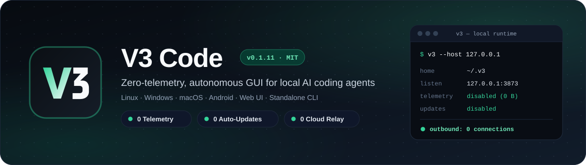
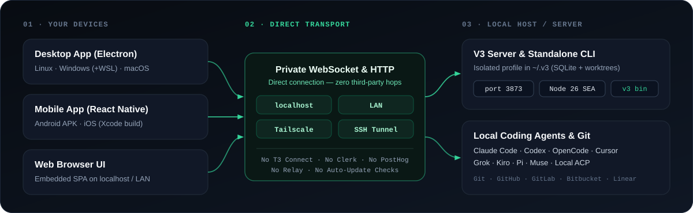

<div align="center">

<picture>
  <source media="(prefers-color-scheme: dark)" srcset="./assets/github/hero-dark.svg" />
  <source media="(prefers-color-scheme: light)" srcset="./assets/github/hero-light.svg" />
  
</picture>

<br />

[](https://github.com/fillvad-cyp/v3-code/releases/tag/v0.2.0)
[](#v3-code-vs-t3-code--в-чём-разница)
[](#v3-code-vs-t3-code--в-чём-разница)
[](#скачать-для-вашего-устройства)
[](./LICENSE)

**Русский** · [English](./README.en.md)

<h3>
  Тот же быстрый T3 Code — только без слежки, без чужих облаков<br />
  и с пачкой крутых фич, которых в оригинале нет.
</h3>

<p>
  <a href="#главные-фичи-v3-code"><strong>Крутые фичи</strong></a> &nbsp;·&nbsp;
  <a href="#v3-code-vs-t3-code--в-чём-разница">Почему мы лучше T3</a> &nbsp;·&nbsp;
  <a href="#скачать-для-вашего-устройства"><strong>Скачать</strong></a> &nbsp;·&nbsp;
  <a href="#архитектура">Как это работает</a>
</p>

</div>

---

## Главные фичи V3 Code

### 1. Ноль слежки и никаких чужих серверов

Обычный T3 Code собирает аналитику, требует чужую авторизацию, гоняет трафик через свои облачные серверы и сам лезет в интернет в фоне.
**В V3 Code мы вырезали всё это под корень.** При запуске программа делает **ровно 0 левых запросов в интернет** — и даже запрещает слежку всем AI-агентам, которых вы запускаете внутри.

### 2. Pop-up / Pop-out окна чатов + режим «Поверх всех окон» (PiP)

Зажми `Ctrl + клик` (или `Cmd + клик` на Mac) по любому чату — он вынесется в отдельное **pop-up окно**, как в Telegram Desktop (работает и в Desktop-приложении, и в браузере).
Можно закрепить чат **поверх всех окон (PiP)**, раскидать 3–4 агента по экрану и спокойно работать в редакторе или браузере, не переключаясь туда-сюда.

### 3. Защита от случайного слива паролей и ключей в AI

Случайно вставил в чат `.env`, API-ключ, пароль от базы или свой локальный путь на диске?
Встроенный фильтр **поймает это прямо до отправки** — предупредит, сам замаскирует секреты звёздочками или вообще заблокирует сообщение.

### 4. Режим «Призрак» (Ghost Mode) — вообще без следов на диске

Запусти `v3 --ghost` — и вся работа живёт **только в оперативной памяти**. Никаких логов, никакой истории на диске. Закрыл программу — всё бесследно стёрлось.

### 5. Прокси, профили и «Красная кнопка» прямо внутри

- **Свои прокси и Tor** с проверкой работы, защитой от утечек и жёстким Kill-Switch (прокси упал — трафик не пойдёт в обход).
- **Раздельные профили (Compartments):** работа, личные проекты и чувствительные задачи не смешиваются — у каждого свой прокси, свой Git-автор, свой браузер и свой часовой пояс. Плюс одноразовый профиль в 1 клик.
- **Сгорающие чаты:** можно поставить таймер (15 минут, час, сутки или «удалить при выходе») — чат сам себя сотрёт.
- **Кнопка «Босс» (`Alt+Shift+L`) и Panic Wipe:** одним нажатием блокируешь и прячешь все окна по паролю, а в экстренном случае сносишь все сессии и кэш за секунду.
- **Автоочистка фото:** перед отправкой картинок V3 сам вырезает из них геолокацию (GPS) и данные камеры.

### 6. Работает на iPhone, Android, ПК и любом сервере

- **iPhone / iPad:** открыл в Safari → нажал «На экран „Домой“» → получил полноценное приложение без App Store, без Xcode и без танцев с бубном.
- **Android:** готовый `.apk` — скачал и поставил.
- **Windows, macOS, Linux:** готовые установщики в один клик, ничего собирать не нужно.
- **Ставится рядом с T3 Code:** свои настройки (`~/.v3`) и свой порт (`3873`) — старый T3 не сломается.

---

## V3 Code vs T3 Code — в чём разница

| Что важно пользователю                          | Официальный T3 Code              | **V3 Code**                               |
| :---------------------------------------------- | :------------------------------- | :---------------------------------------- |
| **Слежка и аналитика**                          | Есть (PostHog, трейсы, сбор ID)  | **Вырезана полностью (0 байт)**           |
| **Нужны чужие аккаунты / облако?**              | Да (Clerk, облачные релеи)       | **Нет — всё работает напрямую**           |
| **Фоновые обновления и запросы**                | Постоянно лезет в сеть сам       | **Отключены навсегда**                    |
| **Pop-up / Pop-out окна чатов + поверх экрана** | Нет                              | **Есть (`Ctrl/Cmd + клик` + PiP)**        |
| **Защита от слива ключей и `.env` в чат**       | Нет                              | **Есть (автомаскировка / блок)**          |
| **Режим без следов на диске (Ghost Mode)**      | Нет                              | **Есть (`v3 --ghost`)**                   |
| **Прокси / Tor + Kill-Switch + профили**        | Нет                              | **Встроено (6 модулей в Privacy Vault)**  |
| **Самоудаляющиеся чаты и «Красная кнопка»**     | Нет                              | **Есть (таймер + Boss Key + Panic Wipe)** |
| **Очистка GPS/EXIF из отправляемых фото**       | Нет                              | **Включена по умолчанию**                 |
| **Приложение на iPhone без Xcode**              | Нет                              | **Есть (PWA в 2 нажатия)**                |
| **Зависимость от чужой инфраструктуры**         | Упадёт облако — отвалится доступ | **Ни от кого не зависит**                 |

> **Итог:** если облако T3 заблокируют, сломают или сделают платным — тебе всё равно. Твои агенты, твой код и твои чаты всегда работают напрямую: локально, по Wi-Fi, через Tailscale или SSH.

---

## Скачать для вашего устройства

Все готовые сборки лежат в **[Releases → `v0.2.0`](https://github.com/fillvad-cyp/v3-code/releases/tag/v0.2.0)** (контрольные суммы: **[SHA256SUMS.txt](https://github.com/fillvad-cyp/v3-code/releases/download/v0.2.0/SHA256SUMS.txt)**). Просто нажми на свою систему — скачивание начнётся сразу.

### Компьютеры и телефоны

| Устройство                  | Архитектура                | Скачать                                                                                                                            | Размер | Примечание                                        |
| :-------------------------- | :------------------------- | :--------------------------------------------------------------------------------------------------------------------------------- | -----: | :------------------------------------------------ |
| **Windows**                 | `x64` (Intel / AMD)        | **[V3-Code-0.2.0-x64.exe](https://github.com/fillvad-cyp/v3-code/releases/download/v0.2.0/V3-Code-0.2.0-x64.exe)**                 | 200 MB | Обычный установщик для Windows 10/11              |
| **Windows**                 | `arm64` (Snapdragon / ARM) | **[V3-Code-0.2.0-arm64.exe](https://github.com/fillvad-cyp/v3-code/releases/download/v0.2.0/V3-Code-0.2.0-arm64.exe)**             | 183 MB | Установщик для Windows на ARM                     |
| **macOS**                   | Apple Silicon (`M1–M4`)    | **[V3-Code-0.2.0-arm64.zip](https://github.com/fillvad-cyp/v3-code/releases/download/v0.2.0/V3-Code-0.2.0-arm64.zip)**             | 212 MB | Готовый `V3 Code.app` для Mac на M-чипах          |
| **macOS**                   | Intel (`x64`)              | **[V3-Code-0.2.0-x64.zip](https://github.com/fillvad-cyp/v3-code/releases/download/v0.2.0/V3-Code-0.2.0-x64.zip)**                 | 217 MB | Готовый `V3 Code.app` для Mac на Intel            |
| **Linux** (любой)           | `x86_64`                   | **[V3-Code-0.2.0-x86_64.AppImage](https://github.com/fillvad-cyp/v3-code/releases/download/v0.2.0/V3-Code-0.2.0-x86_64.AppImage)** | 239 MB | Запуск без установки (`chmod +x`)                 |
| **Linux** (Debian / Ubuntu) | `amd64`                    | **[V3-Code-0.2.0-amd64.deb](https://github.com/fillvad-cyp/v3-code/releases/download/v0.2.0/V3-Code-0.2.0-amd64.deb)**             | 195 MB | Системный пакет `v3code`                          |
| **Android**                 | Все популярные процессоры  | **[V3-Code-0.2.0-android.apk](https://github.com/fillvad-cyp/v3-code/releases/download/v0.2.0/V3-Code-0.2.0-android.apk)**         | 195 MB | Готовый APK, скачал и установил                   |
| **iPhone / iPad**           | Safari (PWA)               | Открыть адрес сервера в Safari                                                                                                     |   0 MB | Поп-ап «На экран „Домой“», работает на весь экран |

### Для серверов и терминала (CLI + Web UI, Node.js не нужен)

Один готовый файл — запускаешь, и у тебя сразу работает сервер с веб-интерфейсом на порту `3873`:

| Платформа                           | Архитектура             | Скачать                                                                                                                          | Размер |
| :---------------------------------- | :---------------------- | :------------------------------------------------------------------------------------------------------------------------------- | -----: |
| **Linux** (VPS / сервер / локально) | `x64`                   | **[v3-0.2.0-linux-x64.tar.gz](https://github.com/fillvad-cyp/v3-code/releases/download/v0.2.0/v3-0.2.0-linux-x64.tar.gz)**       | 177 MB |
| **macOS**                           | Apple Silicon (`arm64`) | **[v3-0.2.0-darwin-arm64.tar.gz](https://github.com/fillvad-cyp/v3-code/releases/download/v0.2.0/v3-0.2.0-darwin-arm64.tar.gz)** | 143 MB |
| **macOS**                           | Intel (`x64`)           | **[v3-0.2.0-darwin-x64.tar.gz](https://github.com/fillvad-cyp/v3-code/releases/download/v0.2.0/v3-0.2.0-darwin-x64.tar.gz)**     | 146 MB |
| **Windows**                         | `x64`                   | **[v3-0.2.0-win32-x64.zip](https://github.com/fillvad-cyp/v3-code/releases/download/v0.2.0/v3-0.2.0-win32-x64.zip)**             | 161 MB |
| **Windows**                         | `arm64`                 | **[v3-0.2.0-win32-arm64.zip](https://github.com/fillvad-cyp/v3-code/releases/download/v0.2.0/v3-0.2.0-win32-arm64.zip)**         | 134 MB |

<details>
<summary><strong>Как установить на Windows, macOS, Linux, Android и iPhone</strong></summary>

#### Windows

Запустите `V3-Code-0.2.0-x64.exe` (или `arm64`). Так как независимая сборка не подписана платным сертификатом Microsoft, в окне SmartScreen нажмите **«Подробнее» → «Выполнить в любом случае»**.

#### macOS

Распакуйте `.zip` и перетащите `V3 Code.app` в папку **Программы (`/Applications`)**. Перед первым запуском один раз выполните в терминале:

```bash
xattr -cr "/Applications/V3 Code.app"
codesign --force --deep --sign - "/Applications/V3 Code.app"
```

#### Linux

```bash
# Debian / Ubuntu
sudo apt install ./V3-Code-0.2.0-amd64.deb

# Любой другой дистрибутив
chmod +x V3-Code-0.2.0-x86_64.AppImage
./V3-Code-0.2.0-x86_64.AppImage
```

#### Android

Скачайте `V3-Code-0.2.0-android.apk` на телефон и откройте файл (либо через `adb install -r V3-Code-0.2.0-android.apk`).

#### iPhone / iPad (без App Store и Xcode)

1. Откройте адрес вашего V3-сервера (по Wi-Fi или Tailscale) в **Safari**.
2. Сразу появится подсказка **«Добавить V3 Code на экран „Домой“»**.
3. Нажмите **«Поделиться» (`□↑`) → «На экран „Домой“» → «Добавить»**.
4. Запускайте V3 Code с рабочего стола как обычное приложение.

#### Сервер / CLI (`v3`)

```bash
tar -xzf v3-0.2.0-linux-x64.tar.gz
./v3-0.2.0-linux-x64/v3
# Откройте http://127.0.0.1:3873 в браузере
```

</details>

---

## Быстрый старт с Ghost Mode и прокси

```bash
# Запуск полностью в оперативной памяти — 0 логов, 0 следов на диске
v3 --ghost

# То же самое + весь трафик через Tor / SOCKS5 без утечек DNS
v3 --ghost --proxy socks5h://127.0.0.1:9050
```

Все настройки приватности, прокси, профилей, DLP-фильтра и «Красной кнопки» также доступны прямо в интерфейсе: **Настройки → Основные → Privacy Shield и Privacy Vault**.

<details>
<summary><strong>Технические подробности (для тех, кто хочет проверить всё под капотом)</strong></summary>

- **Ноль телеметрии и облаков:** удалены PostHog (`ingest.t3.codes`), Axiom OTLP, `expo-observe`, `agent.feedback`, Clerk (`@clerk/*`, Turnstile), T3 Connect, `relay.t3.codes`, `t3.chat`, `cloudflared`, `electron-updater`, Expo EAS OTA, `model-manifest.json`, LiteLLM pricing, ACP CDN, `1.1.1.1` DoH, Google `s2/favicons` и чтение `~/.codex/auth.json` / `~/.claude.json`.
- **Подтверждено проверкой:** `0` исходящих соединений при холодном старте сервера; `0` упоминаний трекеров и облачных доменов в собранных Web/CLI бандлах (1012 файлов) и Android APK.
- **Брандмауэр телеметрии агентов:** автоматически пробрасывает 20 официальных opt-out переменных (`DISABLE_TELEMETRY`, `CLAUDE_CODE_DISABLE_NONESSENTIAL_TRAFFIC`, `CODEX_TELEMETRY_DISABLED`, `OPENCODE_DISABLE_TELEMETRY`, `OTEL_SDK_DISABLED`, `DO_NOT_TRACK`, `SENTRY_DSN=""` и др.) во все дочерние CLI и терминалы.
- **Ghost Mode и `--strict-privacy`:** хранение состояния в `/dev/shm/v3-ghost-*` (`0700`), перезапись файлов нулями перед удалением, вырезание `SSH_*`, `TMUX*`, `VSCODE_*`, `ITERM_*`, `COMPUTERNAME` из дочерних процессов.
- **Privacy Vault (6 модулей):**
  - _Proxy Vault + Kill-Switch_: SOCKS5h/Tor/HTTP(S), массовый импорт, TCP/SOCKS5 пинг, индикатор DNS-утечек, Chromium `--proxy-server` + `--host-resolver-rules` (fail-closed) и вырезание `Sec-CH-UA-*`.
  - _Server & SSH / Tailscale Vault_: пинг серверов и безопасная генерация SSH-команд запуска `v3 --ghost --no-logs` с `-i`, `-J` и SOCKS5 `ProxyCommand`.
  - _Identity Compartments & Burner RAM_: изолированный прокси, Kill-Switch, `GIT_AUTHOR_*`/`GIT_SSH_COMMAND`, часовой пояс, partition браузера и одноразовый RAM-профиль.
  - _Outbound Prompt DLP_: локальный сканер API-ключей, приватных ключей, JWT, `.env`/БД-строк, путей `/home`/`/Users` и IPv4 (`Предупреждать` / `Автомаскировка` / `Блокировать`).
  - _Egress Monitor & Allowlist_: журнал исходящих доменов в реальном времени и белый список (`onBeforeRequest` в Electron) с пресетами LLM-провайдеров.
  - _Шифрование хранилища и Burn-after-TTL_: `AES-256-GCM` + `PBKDF2-SHA256` (310k итераций) для vault-файла, автосжигание чатов по таймеру, локальный код-пароль с защитой от перебора и `POST /api/privacy/panic-logout`.
- **Изоляция от T3 Code:** `~/.v3`, порт `3873`, app ID `org.v3code.app`, URI-схема `v3code://`, бинарник `v3`.

</details>

---

## Архитектура

<div align="center">
<picture>
  <source media="(prefers-color-scheme: dark)" srcset="./assets/github/architecture-dark.svg" />
  <source media="(prefers-color-scheme: light)" srcset="./assets/github/architecture-light.svg" />
  
</picture>
</div>

Все клиенты (**Windows, macOS, Linux, Android, iPhone, браузер**) подключаются **напрямую** к вашему компьютеру или серверу — по `localhost`, домашнему Wi-Fi, **Tailscale** или **SSH**. Никаких посредников между вами и вашим кодом.

---

## Поддерживаемые AI-агенты

Работает со всеми популярными локальными агентами: **Claude Code**, **Codex**, **OpenCode**, **Cursor**, **Grok**, **Kiro**, **Pi**, **Muse Code** и любыми **ACP-агентами**, плюс встроенный **Git** (worktrees, diff, ветки, коммиты) и поддержка **Windows + WSL**.

<details>
<summary><strong>Сборка из исходников (для разработчиков)</strong></summary>

Требуются **Node.js `26.13.1`** и **`pnpm@12.14.0`**:

```bash
pnpm install
pnpm run typecheck
pnpm run build
pnpm run build:desktop
```

Запуск сервера + Web UI из исходников:

```bash
pnpm --filter @t3tools/server start
```

</details>

---

## Лицензия

Распространяется под лицензией **MIT** — см. [LICENSE](./LICENSE).

**V3 Code** — независимый неофициальный форк на базе open-source кода T3 Code (`Copyright (c) 2026 T3 Tools Inc.`). Не аффилирован с T3 Tools, Inc.
